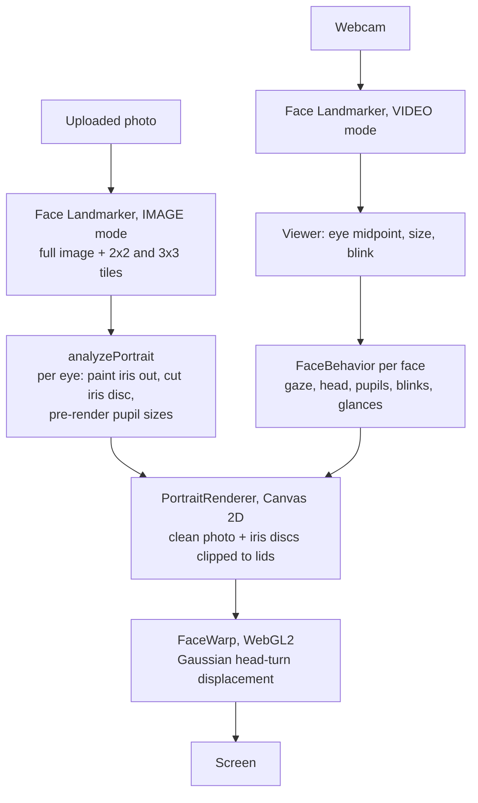

# Eyes

Upload a headshot or group photo. Every face's eyes, and a little of its head, follow whoever stands in front of the webcam. It runs entirely in the browser: no server, no account, and photos never leave the machine.

It works by moving the subject's own iris pixels inside their own eyelids, not by generating images. Any face works, it loads instantly, and it runs at 60fps+ on an ordinary laptop.

## Quick start

    npm install
    npm run dev        # http://localhost:5173

Click **Try the Mona Lisa** or drop in a photo. The camera starts automatically; allow it when the browser asks. Camera access needs `localhost` or HTTPS.

| Command | What it does |
|---|---|
| `npm run dev` | Dev server with hot reload |
| `npm run build` | Type-checks, then builds a static site into `dist/` (host it anywhere) |
| `npm run typecheck` | `tsc --noEmit` |
| `npm run smoke` | Headless end-to-end check (see [Testing](#testing)) |

Each of these first copies MediaPipe's WebAssembly runtime from `node_modules` into `public/wasm`, so nothing loads from a CDN.

## Features

- **Eyes follow the viewer.** Fast, saccade-like eye movement, smoothed with a One Euro filter, plus tiny flicks while holding still and random glances when nobody is in view.
- **Several faces at once.** Group photos work; small faces are found by scanning zoomed-in tiles. Each face has its own timing, so they don't move in lockstep.
- **Head turn.** The middle of each face shifts toward the viewer, a beat behind the eyes (WebGL warp, no seams).
- **Reactions.** Pupils widen as you come closer, briefly widen with a blink when someone new appears, and the face glances away after 5–10 seconds of steady staring.
- **Blinks.** Spontaneous blinks, plus copying the viewer's blinks and winks.
- **Controls.** Drag-and-drop, fullscreen, a bottom bar that hides when the mouse rests, settings saved in `localStorage`, and a debug overlay (press `D`).

### Settings

| Setting | Default | Meaning |
|---|---|---|
| Sensitivity | 1.3 | How far the eyes turn per unit of viewer movement |
| Camera above photo | 8° | Tilts the gaze up to meet the viewer's eyes, because the webcam sits above the screen |
| Smoothing | 0.5 | 0 is twitchy, 1 is very smooth |
| Head turn | 0.5 | How much of the gaze the head follows (0 turns it off) |
| React | on | Pupil size, surprise and glancing away |
| Blink on its own | on | Spontaneous blinks |
| Copy my blinks and winks | on | Mirrors the viewer's eyelids |
| Debug overlay | off | Draws eyelid contours, the iris circle and the gaze target, and shows the webcam picture-in-picture |

## How it works

Once per photo:

1. **Find the faces.** MediaPipe Face Landmarker (WebAssembly, GPU delegate with CPU fallback) returns 478 landmarks per face, including eyelid contours and iris center and radius. It runs on the full image and on overlapping tiles, and duplicates are merged.
2. **Paint the iris out.** Each iris hole is filled row by row from nearby pixels that look like eye white (bright and not skin-coloured), smoothed, then shaded under the upper lid. A push-pull fill covers whatever the row fill can't reach.
3. **Cut a movable iris.** The visible iris becomes a disc. Parts hidden under the lids are rebuilt by rotating visible iris texture around the center, skipping bright catchlights. Discs are pre-rendered at nine pupil sizes.

Every frame:

4. **Track the viewer.** A second landmarker on the webcam picks the closest face. Its eye midpoint maps to a gaze angle using an assumed 62° webcam field of view.
5. **Behave.** Per face: smoothed gaze, a lazier head, pupil size, blinks and stare-and-glance timing.
6. **Render.** Draw the cleaned photo, then each iris disc at its new position: foreshortened as it turns, clipped to the eye opening, with a shadow from the upper lid. Blinks slide the skin above the eye down over it. A WebGL pass then nudges each face's middle toward its gaze.

## Best results

- A front-facing, well-lit photo with open eyes looking at the camera. The app assumes the photo's gaze is its resting "straight ahead".
- Eyes at least 40–50px wide. The app warns when they're smaller.
- Squinting or smiling eyes work, but the eye white revealed as the iris moves looks flat, because there's little real eye white to copy from.
- Glasses glare and strong side lighting degrade the iris fill.

## Testing

`npm run smoke` serves the app, opens it in headless Chromium, loads a photo, and drives the gaze through a test hook (`window.eyesTest`). It checks that faces are found, the camera starts, the portrait changes as the viewer moves, and the page throws no errors. Screenshots go to `test-output/`.

    npx playwright install chromium               # once
    npm run smoke                                  # Mona Lisa
    npm run smoke -- photo.jpg                     # your photo
    npm run smoke -- photo.jpg --video face.y4m    # also feed a fake webcam clip

Set `CHROME_PATH` to use a different Chrome binary. To turn a clip into a `.y4m` file: `ffmpeg -i clip.mp4 -vf scale=640:480 -pix_fmt yuv420p face.y4m`.

## Browser support

Developed and tested in Chrome on macOS (Apple Silicon). The app needs WebAssembly and `getUserMedia`. Without WebGL2 the head turn is turned off and everything else still works.

## Prior art

- [Mona Lisa Effect](https://monalisaeffect.com/) by Emily Xie ([write-up](https://blog.tensorflow.org/2020/09/bringing-mona-lisa-effect-to-life-tensorflow-js.html)): the same idea for one painting, using animation frames generated ahead of time. This project works on any uploaded photo.
- [LivePortrait](https://huggingface.co/KwaiVGI/LivePortrait): neural portrait animation with real head turns. Too heavy to run live in a browser today. The upgrade path is to render a pose grid once per photo and blend between poses live (see `CLAUDE.md`).

## Licenses

- Code: MIT (see `LICENSE`).
- `public/models/face_landmarker.task` and `@mediapipe/tasks-vision`: Google, Apache-2.0.
- `public/sample.jpg`: *Mona Lisa*, Leonardo da Vinci, public domain (via Wikimedia Commons).
